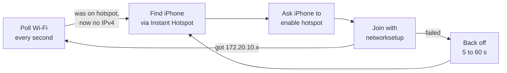
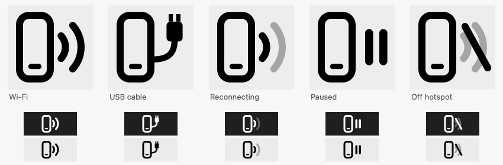

# hotspot-recover

**Your Mac keeps falling off your iPhone's Personal Hotspot. This puts it back, in seconds, without you touching the Wi-Fi menu.**


`hotspot-recover` is a tiny background agent for macOS. It notices when the Wi-Fi link to your iPhone hotspot drops, wakes the hotspot the same way the Wi-Fi menu does, and re-joins it.

```
23:40:19 connection drop detected on en0, recovering
23:40:19 device found: My iPhone
23:40:19 hotspot enabled ("My iPhone")
23:40:26 joined hotspot in 7.0 s
```

## Why the usual reconnect scripts don't work

When the Mac drops off, the iPhone stops broadcasting the hotspot. A sleeping hotspot does not show up in Wi-Fi scans, so `networksetup -setairportnetwork` fails with "Could not find network", and toggling Wi-Fi off and on doesn't bring it back either.

Clicking the phone in the Wi-Fi menu works because macOS first wakes it over Bluetooth (Instant Hotspot). `hotspot-recover` makes that same request from code, then joins.

## How it works



1. Once a second it reads the Wi-Fi interface's IPv4 address. An address in `172.20.10.0/28` means "on an iPhone hotspot". The SSID is not used, because macOS hides it from tools without Location permission.
2. If the Mac was on the hotspot (over Wi-Fi or USB), and now Wi-Fi is on but has no address for two polls and there is no USB link to the phone, recovery starts.
3. Recovery uses the private `SFRemoteHotspotSession` class in `Sharing.framework` to find the iPhone and ask it to turn the hotspot on. The phone answers with the network name and password.
4. It joins with `/usr/sbin/networksetup` and waits for a hotspot address.
5. If anything fails it retries after 5, 10, 20, 40, then every 60 seconds.

It stays out of the way when:

- Wi-Fi is turned off.
- The Mac is on any other network. It never disconnects you from a network to move you to the hotspot.
- You left another network. Once Wi-Fi has been on a different network, it waits until you join the hotspot yourself again.
- The Mac just woke from sleep or Wi-Fi was just turned on. It waits 10 seconds first, so macOS can join a known network nearby instead of the phone.

## Menu bar

The agent shows its own icon in the menu bar: a phone sending signal. It changes with the state, and the waves light up in turn while it reconnects.



The menu has:

- The current status and, after the first recovery, the time and result of the last one.
- **Reconnect Now** runs one recovery immediately.
- **Pause Auto-Reconnect** stops automatic recoveries until you turn it off or the agent restarts.
- **Reconnect After Restart** is the `--always` behaviour, remembered between launches.
- **Show Log** opens the log file.
- **Quit hotspot-recover** stops the agent. It stays quit until your next login, or until you run `launchctl kickstart gui/$UID/com.github.hotspot-recover`. launchd only restarts it after a crash.

Use `--no-menu` to run without the icon.

## Install

Requires macOS 13 or later and the Xcode Command Line Tools (`xcode-select --install`).

```sh
git clone https://github.com/furkananter/hotspot-recover.git
cd hotspot-recover
./install.sh
```

This builds the binary, copies it to `~/.local/bin/hotspot-recover`, and starts it as a launchd user agent that also runs at login. No `sudo` is needed.

Join your hotspot once after installing. From then on, drops are recovered automatically.

To remove it:

```sh
./uninstall.sh
```

## Options

Arguments given to `install.sh` are passed on to the agent, for example `./install.sh --device "My iPhone"`.

| Option | Effect |
| --- | --- |
| *(none)* | Show the menu bar icon and watch forever. |
| `--no-menu` | Watch forever without the menu bar icon. |
| `--once` | Run one recovery now and exit. Exit code 0 means joined. |
| `--device <name>` | Only use the hotspot device with this name. Default: the first one found. |
| `--always` | Recover whenever Wi-Fi is on and has had no address for 10 s, even if the agent has not seen the hotspot yet (for example right after a reboot). Also switches on "Reconnect After Restart" in the menu. |
| `--help` | Show usage. |

## Logs

```sh
tail -f ~/Library/Logs/hotspot-recover.log
```

One line per event. The file is readable only by your user.

## Security

- **No root.** It runs as your user. Nothing is installed outside your home directory.
- **No network access of its own.** It opens no sockets, listens on nothing, and sends nothing anywhere.
- **The hotspot password is never stored, logged, or put on a command line.** It is held in memory for the few seconds of a join and handed to `networksetup` over stdin, so it does not appear in `ps`.
- **No shell.** `networksetup` is launched by absolute path with an argument array, so a network name cannot inject commands.
- **Only your own devices.** The phone is found through Instant Hotspot, which lists devices signed in to your Apple Account.
- **No extra permissions.** It does not ask for Accessibility, Location, or Full Disk Access. The menu bar icon needs no permission either.
- **No dependencies.** One Swift file, about 560 lines. Read it before you run it.

If you find a security problem, please open an issue.

## Limitations

- **It uses a private Apple API.** `SFRemoteHotspotSession` is undocumented and can change or disappear in any macOS update. At launch the agent checks that the class and every method it calls still exist. If anything is missing, it turns auto-reconnect off, shows "Not supported on this macOS" in the menu and logs what is missing, instead of calling into an API that is no longer there.
- **Tested only on macOS 15.7** with one iPhone. Reports from other versions are welcome.
- **The iPhone must be nearby**, signed in to the same Apple Account, with Bluetooth on.
- **It needs to see the hotspot once.** Without `--always`, nothing happens after a reboot until you join the hotspot yourself.
- **It will re-join if you disconnect from the hotspot by hand.** Turn Wi-Fi off, join another network, or run `./uninstall.sh` to stop it.
- **If macOS auto-joins another saved network after a drop, the agent stands down.**

## With a USB cable

If the iPhone is also plugged in, macOS switches to the USB tethering link by itself when Wi-Fi drops (about a second in testing). The agent detects that link, a second interface with a `172.20.10.x` address, and leaves things alone while it is up. If the cable link goes away too, it recovers the Wi-Fi hotspot.

## Prior art

[notCorwin/Sequoia-Hotspot](https://github.com/notCorwin/Sequoia-Hotspot) and [bestutsengineer/caffeine](https://github.com/bestutsengineer/caffeine) use the same private API. This project was written independently and shares no code with them.

## License

[MIT](LICENSE)
